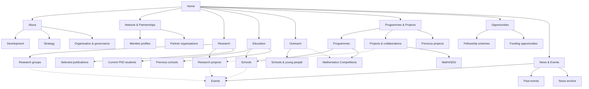

# CoRE-Math website site map

Snapshot: 18 October 2026. This map is derived from the Jekyll configuration, content collections, front matter, and the main navigation at that time. URLs are site-relative and resolve from the production site root, `https://www.africaeuropecoremath.org/`. Refresh the map after structural or route changes; it is not a live catalogue.

**Main navigation** marks pages present in the desktop rail and mobile menu. Other entries are published pages reached from those sections, contextual links, listings, or legacy redirects.

## Visual overview

- **[Home](/)** — main navigation
  - [About CoRE-Math](/about/) — main navigation
    - [The development of CoRE-Math](/about/development/)
    - [CoRE-Math Strategy](/about/strategy/)
    - [Organisation and governance](/about/organisation/)
  - [Network & Partnerships](/network-partnerships/) — main navigation
    - **Member-university profiles** — 17 interactive dialogs on the Network page; they are not standalone URLs.
      - Addis Ababa University; Linköping University; LUT University; Makerere University; Stellenbosch University; Stockholm University; University of Amsterdam; University of Bergen; University of Dar es Salaam; University of Groningen; University of KwaZulu-Natal; University of Nairobi; University of Oslo; University of Rwanda; University of Vienna; University of Zambia; Uppsala University.
    - **Formal partners** — external destinations only: ECMI, ICIAM, ISP.
    - **Other partners** — external destinations only: CIMPA, CoE-MaSS, ICTP, NGA(MaSS).
  - [Research](/research/) — main navigation
    - **Research groups**
      - [AECC – African Enumerative Combinatorics Community](/research-groups/aecc/)
      - [APREA – Applied Probability Research in Eastern Africa](/research-groups/aprea/)
      - [EAALG – Eastern Africa Algebra Research Group](/research-groups/eaalg/)
      - [PDEAPP – Partial Differential Equations and Applications](/research-groups/pdeapp/)
    - [Selected publications](/research/publications/)
    - **Research projects and collaborations** (also linked from Programmes & Projects)
      - [Applied Mathematics for Earth Observation](/projects/applied-mathematics-for-earth-observation/)
      - [Flagship of Advanced Mathematics for Sensing, Imaging and Modelling (FAME)](/projects/fame/)
      - [Lake Victoria Living Lab](/projects/lake-victoria/)
      - [Mathematics for Sustainable Development (Math4SDG)](/projects/math4sdg/)
      - [Sida-supported collaboration](/projects/sida-supported-collaboration/)
      - [SPIRIT](/projects/spirit/)
  - [Education](/education/) — main navigation
    - [Current PhD students](/education/phd-students/)
    - [Previous schools](/education/schools/)
    - **Upcoming schools** — event detail pages, selected automatically from the Events collection
      - [CIMPA School on Algebraic and Enumerative Combinatorics](/events/2027-algebraic-enumerative-combinatorics/)
      - [Summer School on Topological Data Analysis and Applications](/events/2027-topological-data-analysis-lusaka/)
      - [Modern Perspectives on Partial Differential Equations: Theory and Applications](/events/2027-modern-perspectives-pdes/)
  - [Outreach](/outreach/) — main navigation
    - [Schools and young people](/outreach/schools-and-young-people/)
    - [Mathematics Competitions](/programmes/mathematics-competitions/)
  - [Programmes & Projects](/projects/) — main navigation
    - **Programmes**
      - [CoRE-Math Fellowships](/programmes/core-math-fellowships/)
        - [CoRE-Math Fellowships at Uppsala University](/programmes/core-math-fellowships/uppsala-university/)
        - [CoRE-Math Fellowships at the University of KwaZulu-Natal](/programmes/core-math-fellowships/university-of-kwazulu-natal/)
      - [CoRE-Math Schools](/programmes/core-math-schools/)
      - [Industrial Mathematics](/programmes/study-groups-with-industry/)
      - [Mathematics Competitions](/programmes/mathematics-competitions/)
      - [Women in Math](/programmes/women-in-math/)
    - **Projects and collaborations**
      - [Applied Mathematics for Earth Observation](/projects/applied-mathematics-for-earth-observation/)
      - [Flagship of Advanced Mathematics for Sensing, Imaging and Modelling (FAME)](/projects/fame/)
      - [Lake Victoria Living Lab](/projects/lake-victoria/)
      - [Mathematics for Sustainable Development (Math4SDG)](/projects/math4sdg/)
      - [Sida-supported collaboration](/projects/sida-supported-collaboration/)
      - [SPIRIT](/projects/spirit/)
      - Catalogue-only collaborations: Mathematics Capacity Building in Rwanda; Bergen–Makerere–UDSM mobility and postgraduate collaboration; Data Skills and Industry Readiness Training Program; Makerere–Groningen mobility and research collaboration; Waterproof; Collaborative Research – Renewable Energy; Health Data Synergy: Bridging Medicine and Mathematics.
    - [Previous projects](/projects/previous/)
  - [Opportunities](/opportunities/) — main navigation
    - Fellowship scheme detail pages (also listed under CoRE-Math Fellowships)
      - [CoRE-Math Fellowships at Uppsala University](/programmes/core-math-fellowships/uppsala-university/)
      - [CoRE-Math Fellowships at the University of KwaZulu-Natal](/programmes/core-math-fellowships/university-of-kwazulu-natal/)
    - Funding opportunities — dynamic records shown on the landing page; no individual CoRE-Math pages.
  - [News & Events](/news-events/) — main navigation
    - [Past events](/events/archive/)
    - [News Archive 2024](/news/archive/2024/)
    - [News Archive 2025](/news/archive/2025/)
    - [News Archive 2026](/news/archive/2026/)
    - **Events**
      - [1st EAALG Workshop: Introduction to Homological Algebra and Discrete Geometry](/events/2021-eaalg-homological-algebra-discrete-geometry/)
      - [2nd EAALG Workshop: Some Topics in Algebra and Geometry](/events/2023-eaalg-algebra-geometry/)
      - [3rd EAALG Workshop: Some Topics in Algebra and Geometry](/events/2024-eaalg-algebra-geometry/)
      - [EAALG Workshop and 10th Anniversary Nairobi Workshop in Algebraic Geometry](/events/2025-eaalg-nairobi-workshop-algebraic-geometry/)
      - [2026 School on Arithmetic, Geometry and Algorithms](/events/2026-arithmetic-geometry-algorithms-addis-ababa/)
      - [Study Group with Industry in Kampala](/events/2026-kampala-study-group-with-industry/)
      - [Lake Victoria Workshop](/events/2026-lake-victoria-workshop/)
      - [Mathematical and Computational Solutions to Industry Challenges](/events/2026-mathematical-computational-solutions-industry-challenges/)
      - [Austria–Uganda Workshop on Algebra and Geometry](/events/2027-austria-uganda-workshop-algebra-geometry/)
      - [Pan-African Mathematics Olympiad (PAMO 2027)](/events/2027-pan-african-mathematics-olympiad/)
      - [CIMPA School on Algebraic and Enumerative Combinatorics](/events/2027-algebraic-enumerative-combinatorics/)
      - [Summer School on Topological Data Analysis and Applications](/events/2027-topological-data-analysis-lusaka/)
      - [Modern Perspectives on Partial Differential Equations: Theory and Applications](/events/2027-modern-perspectives-pdes/)
      - [Inaugural Pan-African AECC Research Workshop on Enumerative Combinatorics](/events/2027-pan-african-aecc-workshop/)
    - **News articles**
      - **2024**
        - [Kick-off meeting of the European partners in Uppsala](/news/2024/kick-off-meeting-with-the-european-partners-in-uppsala/)
      - **2025**
        - [CIMPA School on Effective Algebra and the LMFBD at Makerere](/news/2025/cimpa-school-on-effective-algebra-and-the-lmfbd-at-makerere/)
        - [ICTP-EAUMP Summer School 2025](/news/2025/ictp-eaump-summer-school-2025/)
        - [Samya Suleiman successfully defends PhD at UDSM](/news/2025/samya-suleiman-successfully-defends-phd-at-udsm/)
        - [Coimbra Group Scholarship Programme](/news/2025/coimbra-group-scholarship-programme/)
        - [Second stage of Mathematics Competitions in Rwanda](/news/2025/second-stage-of-mathematics-competitions-in-rwanda/)
        - [Ethio-Italy Colloquium on Applied Mathematics (ETICAM-2)](/news/2025/ethio-italy-colloquium-on-applied-mathematics-eticam-2/)
        - [Teklemichael Worku successfully defends his PhD in Mathematics.](/news/2025/teklemichael-worku-successfully-defends-his-phd-in-mathematics/)
        - [Herbert Batte successfully defends his PhD at Makerere University](/news/2025/happening-on-14th-march-2025-mr-herbert-batte-s-phd-defense-at-makerere-university/)
        - [Award for Strong Leadership and Innovation to Dr Celestin Kurujyibwami](/news/2025/award-for-strong-leadership-and-innovation-to-dr-celestin-kurujyibwami/)
        - [Meeting in Amsterdam dedicated to Collaborations with African Partners](/news/2025/meeting-in-amsterdam-dedicated-to-collaborations-with-african-partners/)
        - [Kenya celebrates International Day of Mathematics with Pi-Day Competitions](/news/2025/kenya-celebrates-international-day-of-mathematics-with-pi-day-competitions/)
        - [Tanzania celebrates International Day of Mathematics](/news/2025/tanzania-celebrates-international-day-of-mathematics/)
        - [Mathematical Sciences Sponsorship Fund](/news/2025/mathematical-sciences-sponsorship-fund/)
        - [Online events for ERC Starting Grants for researchers based in Africa](/news/2025/online-events-for-erc-starting-grants-for-researchers-based-in-africa/)
        - [EU funding for Generative AI for Africa](/news/2025/eu-funding-for-generative-ai-for-africa/)
        - [CoRE-Math Fellowships in Mathematics at Uppsala University](/news/2025/core-math-fellowships-in-mathematics-at-uppsala-university/)
        - [Zambia Graduates Eight ISP Funded MSc Students](/news/2025/zambia-graduates-eight-isp-funded-msc-students/)
        - [East African Mathematical Olympiad](/news/2025/east-african-mathematical-olympiad/)
        - [Bizuneh Minda Demissie successfully defends PhD at Addis Ababa University](/news/2025/bizuneh-minda-demissie-successfully-defends-his-phd-at-addis-ababa-university/)
        - [SAMSA Conference 2025](/news/2025/samsa-conference-2025/)
        - [The 2nd European Summer Program in Infectious Disease Analysis and Modelling (ESPIDAM)](/news/2025/the-2nd-european-summer-program-in-infectious-disease-analysis-and-modelling-espidam/)
        - [Online Seminar Series on Enumerative Combinatorics](/news/2025/online-seminar-series-on-enumerative-combinatorics/)
        - [2025 Nairobi Workshop in Algebraic Geometry](/news/2025/2025-nairobi-workshop-in-algebraic-geometry/)
        - [Austria-Uganda workshop in geometry and representation theory](/news/2025/austria-uganda-workshop-in-geometry-and-representation-theory/)
        - [ICTP-EAUMP Summer school on Real and Harmonic Analysis](/news/2025/ictp-eaump-summer-school-on-real-and-harmonic-analysis/)
        - [LUT University's UNESCO Chair focuses on digital transformation in Africa](/news/2025/lut-university-s-unesco-chair-focuses-on-digital-transformation-in-africa/)
        - [Global South Fellowship Scheme at the University of Amsterdam](/news/2025/global-south-fellowship-scheme-at-the-university-of-amsterdam/)
        - [NITheCS Seminar Series](/news/2025/nithecs-seminar-series/)
        - [The Second African-Nordic Conference in Mathematics](/news/2025/the-second-african-nordic-conference-in-mathematics/)
        - [University of Bergen to host a symposium on Africa-Europe Research Collaborations](/news/2025/university-of-bergen-to-host-a-symposium-on-africa-europe-research-collaborations/)
      - **2026**
        - [Online Combinatorics Seminars](/news/2026/online-combinatorics-seminars/)
        - [Seminar in "Telescoping Physics of the Early Universe" at the University of KwaZulu-Natal](/news/2026/seminar-in-telescoping-physics-of-the-early-universe-at-the-university-of-kwazulu-natal/)
        - [TWAS-DFG Cooperation Visits Programme](/news/2026/twas-dfg-cooperation-visits-programme/)
        - [CoRE-Math Fellowships in Mathematics at Uppsala University, Round II](/news/2026/core-math-fellowships-in-mathematics-at-uppsala-university-round-ii/)
        - [Mathematics and industry meet in Kampala](/news/2026/mathematics-and-industry-meet-in-kampala/)
        - [SPIRIT project strengthens research on gender disparities in Rwanda](/news/2026/spirit-project-strengthens-research-on-gender-disparities-in-rwanda/)
        - [New TFK-funded collaboration strengthens CoRE-Math partnership with Rwanda](/news/2026/new-tfk-funded-collaboration-strengthens-core-math-partnership-with-rwanda/)
        - [The Second African-Nordic Conference in Mathematics](/news/2026/african-nordic-conference/)
        - [2026 School on Arithmetic, Geometry and Algorithms](/news/2026/2026-school-on-arithmetic-geometry-and-algorithms/)
        - [African Research School on Optimal Transport](/news/2026/african-research-school-on-optimal-transport/)
        - [Study Group with Industry in Kampala](/news/2026/study-group-with-industry/)
        - [Four CoRE-Math fellowships at UKZN for 2027](/news/2026/four-core-math-fellowships-at-ukzn-for-2027/)
        - [AI and mathematics education in the Global South: new IAS fellowship](/news/2026/ai-and-mathematics-education-in-the-global-south-new-ias-fellowship/)
  - [Contact](/contact/) — footer only

## Compatibility redirects

These routes are published to preserve older links; they are not presented as ordinary navigation destinations.

- [2026 School on Arithmetic, Geometry and Algorithms](/projects/arithmetic-geometry-summer-school-2026/) → [event page](/events/2026-arithmetic-geometry-algorithms-addis-ababa/)
- [Women in Math](/projects/gender-and-inclusion/) → [programme page](/programmes/women-in-math/)
- [Study Group with Industry in Kampala](/projects/kampala-sgi-2026/) → [event page](/events/2026-kampala-study-group-with-industry/)
- [Summer School on Topological Data Analysis and Applications](/projects/topological-data-analysis-summer-school-2027/) → [event page](/events/2027-topological-data-analysis-lusaka/)

## Notes on generated resources

- The `_publications` collection is configured with `output: false`; publication records are rendered in the Selected publications and research-group pages, not as individual public pages.
- Funding-opportunity records are held in `_data/open_opportunities.json` and rendered on the Opportunities landing page, not as individual public pages.
- University profiles are accessible dialogs on the Network & Partnerships page. They are not separate, indexable routes.
